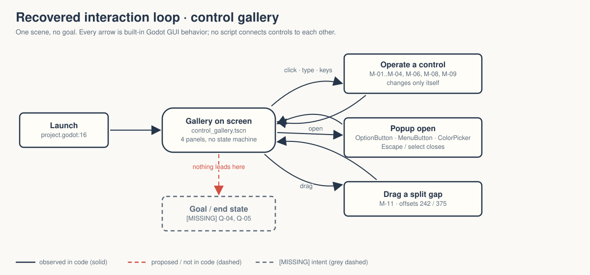
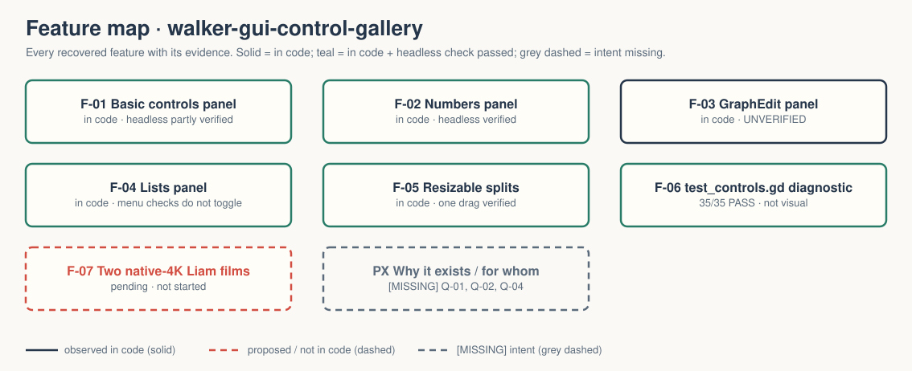

# walker-gui-control-gallery — Game Design Document (recovered)

| | |
|---|---|
| Version | 0.1.0-recovered |
| Date | 2026-09-27 |
| Author | Zelda (agent, silent), for Nik Bear Brown |
| Mode | recovered — `/gdd reverse --path godot silent` |
| Revision | 1 |
| Gates | gate — unsigned at time of writing · vision ○ · systems ○ · world ○ · scope ○ |
| Source | Godot demo `gui/control_gallery`, commit `a3b5c113112f77291d5f3d1360f33a882fdc52f7`; Walker change is the project title only |
| What this is | **A tech demo, not a game.** A single static screen of Godot Control nodes. |

Provenance tags: `[OBSERVED path:line]` the code or a project file does this · `[INFERRED]` the code strongly implies this, evidence stated · `[MISSING]` nothing in the folder can tell us this; each one is an open question in `design/decisions.md`. Paths are relative to the project folder (the folder that contains `godot/`). This file is identical at `GDD.md` and `design/GDD.md`.

A recovered GDD describes what exists. It approves nothing, and it is not evidence that anything here was designed as a game.

Evidence image: `godot/screenshots/control_gallery.webp` is the **upstream** demo screenshot kept with the copy `[OBSERVED README.md:6-7]`. It is not a Walker capture; no Walker capture exists (`FRICTIONAL.md`, films pending).

## 1. Vision summary

**Logline (recovered).** "Showcases various Control nodes with their names affixed for easy recognition." `[OBSERVED godot/project.godot:14]` The upstream README adds that it is inspired by the control galleries of GUI toolkits such as GTK `[OBSERVED godot/README.md:4-5]`.

**Player fantasy.** None. There is no player role, goal, challenge, or ending. `[INFERRED]` — the scene declares no `[connection]` entries and the only script (`godot/tree.gd`) populates a Tree and nothing else.

**Who it is for.** `[MISSING → Q-02]` Upstream tags it `demo`, `gui`, `official` `[OBSERVED godot/project.godot:15]`, which suggests Godot learners browsing widgets; who it serves inside Walker is not written anywhere.

**Why it is in Walker.** `[MISSING → Q-01]` The local README and FRICTIONAL.md record copying, verification and two pending "native-4K Liam films" `[OBSERVED README.md:10-11; FRICTIONAL.md:26-27]`, which implies the folder exists as a film/teaching subject `[INFERRED]`, but no sentence states its purpose.

## 2. Design pillars

`[MISSING → Q-03]` No pillars exist. The structure suggests two de-facto rules `[INFERRED from godot/control_gallery.tscn]`:
- **Every control labels itself.** Each widget's text is its own class name ("Button", "CheckBox", "SpinBox" prefix …) `[OBSERVED godot/control_gallery.tscn:86,112,116,120,377]`.
- **Every control stands alone.** No control drives another; the ProgressBar stays at 50 while the HSlider moves `[OBSERVED godot/test_controls.gd:62; controls-expanded-input-20260924.log]`.

These are observations of a reference sheet, not approved pillars.

## 3. Core loop

- **Second to second.** Point at a control, operate it (click, type, drag, keyboard), see that control's own state change. `[OBSERVED — 35 input-driven assertions, controls-expanded-input-20260924.log]`
- **Minute to minute.** Move between the four panels (Basic controls, Numbers, GraphEdit, Lists); resize panels by dragging split gaps `[OBSERVED godot/README.md:7-10; godot/control_gallery.tscn:54,342,352]`.
- **Session.** Launch into the one scene, browse, close the window. There is no win, fail, save, or restart state. `[OBSERVED godot/project.godot:16 single main scene; no save code in godot/]`

This is a browse loop, not a game loop: no feedback is tied to an objective. `[INFERRED]`

## 4. Player Experience Goals

`[MISSING → Q-04]` None are declared. What the code could plausibly serve, stated only as evidence of structure `[INFERRED]`:
- Recognise a Control by sight and name (names are printed on every widget).
- See default-theme behavior of interactive widgets (tooltips, popups, disabled states: disabled OptionButton item, disabled ItemList row, disabled Tree button, disabled menu check item) `[OBSERVED godot/control_gallery.tscn:518,541,583; godot/tree.gd:11]`.

Without a declared goal, no feature below can be mapped to a PX goal; that is the Ghost Center (see Zelda's read).

## 5. Mechanics

Numbers here are observed defaults, not tuned design.

- **M-01 Buttons and toggles** — Button, LinkButton with a multi-line tooltip, CheckBox, CheckButton `[OBSERVED godot/control_gallery.tscn:84-117]`. Mouse toggles on/off verified headless `[OBSERVED godot/test_controls.gd:32-37]`.
- **M-02 Text entry** — LineEdit with placeholder; TextEdit (multi-line, `tab_input_mode = false`); CodeEdit with highlighter, line numbers, folding, completion, a line-length guideline at 24 `[OBSERVED godot/control_gallery.tscn:118-157]`. Typing/backspace and newline verified; syntax highlighting not verified `[OBSERVED godot/test_controls.gd:52-54,121; FRICTIONAL.md:40-41]`.
- **M-03 Tabs** — TabContainer with 7 tabs, each a RichTextLabel naming the selected tab in a different color `[OBSERVED godot/control_gallery.tscn:163-340]`. Keyboard tab selection verified `[OBSERVED godot/test_controls.gd:43]`.
- **M-04 Numbers** — SpinBox (prefix "SpinBox"), HSlider at 50, ProgressBar at 50, HSeparator, TextureProgressBar at 67 using the icon, fill mode 4 `[OBSERVED godot/control_gallery.tscn:373-442]`. Typed SpinBox value 42 and slider bounds 0/100 verified `[OBSERVED godot/test_controls.gd:59-61,116]`.
- **M-05 Graph** — GraphEdit containing a GraphFrame and one GraphNode, minimap 72×72 `[OBSERVED godot/control_gallery.tscn:457-476]`. Graph manipulation **not verified** `[OBSERVED FRICTIONAL.md:40-41]`.
- **M-06 Pick-one lists** — OptionButton (5 items incl. separator and a disabled item) `[OBSERVED godot/control_gallery.tscn:502-518]`; three CheckBoxes sharing a ButtonGroup (exclusive radio) `[OBSERVED godot/control_gallery.tscn:553-571; test_controls.gd:72]`.
- **M-07 Menus** — MenuButton with an action item, two checkbox items, a disabled checkbox item, two radio items `[OBSERVED godot/control_gallery.tscn:520-551]`. **No handler toggles the check items**; FRICTIONAL warns not to claim they toggle `[OBSERVED FRICTIONAL.md:25]`.
- **M-08 Multi-select list and tree** — ItemList (`select_mode = 1` multi, one disabled row with icon) `[OBSERVED godot/control_gallery.tscn:573-585]`; Tree built by `tree.gd` (root with two buttons, one disabled; two children; one grandchild) `[OBSERVED godot/tree.gd:5-18]`. Disabled row refused, tree hierarchy verified `[OBSERVED godot/test_controls.gd:75-76,125-127]`.
- **M-09 Foldables** — two FoldableContainers in one FoldableGroup: only one open at a time, the second opens from the bottom `[OBSERVED godot/control_gallery.tscn:597-634]`; verified `[OBSERVED godot/test_controls.gd:81-84]`.
- **M-10 Color picking** — ColorPickerButton (initial color 0.28, 0.55, 0.75) opens and dismisses on Escape `[OBSERVED godot/control_gallery.tscn:99-103; test_controls.gd:138-141]`. Color change visuals not verified.
- **M-11 Resizable layout** — nested HSplit/VSplit containers with offsets 242 and 375; an 80 px mouse drag changes the horizontal offset `[OBSERVED godot/control_gallery.tscn:348-358; test_controls.gd:164]`.

## 6. Systems

- **S-01 Scene tree.** One scene, root `Control` → `MainPanel` (ColorRect, 0.21 grey) → splits → four PanelContainers sharing one StyleBoxFlat `[OBSERVED godot/control_gallery.tscn:6,37-69,342-484]`.
- **S-02 Scripts.** One gameplay-side script, `tree.gd`, marked `@tool` so it also runs in the editor `[OBSERVED godot/tree.gd:1]`. One Walker diagnostic, `test_controls.gd` (SceneTree script, not loaded by the game) `[OBSERVED godot/test_controls.gd:1]`.
- **S-03 Input.** No `[input]` section; all input is Godot's built-in GUI handling `[OBSERVED godot/project.godot:1-34]`. No custom signals, no exported vars.
- **S-04 Save/load, scene transitions, autoloads.** None `[OBSERVED — none declared in godot/project.godot; no code in godot/]`.
- **S-05 Display.** `canvas_items` stretch, `expand` aspect, vsync off, low-processor mode on `[OBSERVED godot/project.godot:18,27-29]`.

## 7. Progression

None. There are no stages, unlocks, difficulty, or end state `[OBSERVED — single scene, no state code]`. Whether any progression (a guided tour, a checklist of controls) is wanted is `[MISSING → Q-05]`.

## 8. World

No world. The "space" is a dark-grey panel layout `[OBSERVED godot/control_gallery.tscn:45-52]`. No lore exists and none is inferred.

## 9. Narrative

None. Reasoned N/A: the only text is widget self-labels and the tab/foldable captions `[OBSERVED godot/control_gallery.tscn:188-338,612,633]`.

## 10. Characters

None.

## 11. Features and priority

| ID | Feature | Tag | PX | Evidence | Status |
|---|---|---|---|---|---|
| F-01 | Basic controls panel (M-01, M-02, M-03, M-10) | untagged | none declared | scene :69-340 | in code; headless state verified in part |
| F-02 | Numbers panel (M-04) | untagged | none | scene :360-442 | in code; headless verified |
| F-03 | GraphEdit panel (M-05) | untagged | none | scene :444-476 | in code; **unverified** |
| F-04 | Lists panel (M-06..M-09) | untagged | none | scene :477-634, tree.gd | in code; headless verified except menu check toggling |
| F-05 | Resizable split layout (M-11) | untagged | none | scene :54,342,352 | in code; one drag verified |
| F-06 | Headless diagnostic `test_controls.gd` | Walker tooling | — | 35/35 in controls-expanded-input-20260924.log | passes; not visual evidence |
| F-07 | Two native-4K Liam films | Walker production | — | README.md:10-11 | **pending, not started** |

**CORE percentage:** not computable; no feature carries a CORE/IMPORTANT/NICE tag and nothing defines an MVP `[MISSING → Q-05]`. Recorded, not decided.

## 12. Out of scope

Recovered by absence, not by decision `[INFERRED]`: gameplay, scoring, save data, theming beyond one StyleBoxFlat, localization, accessibility review. FRICTIONAL.md explicitly treats rendered layout, color changes, code highlighting and graph manipulation as not yet verified, not as out of scope `[OBSERVED FRICTIONAL.md:40-43]`.

## 13. Technical

Godot 4.7.2 stable (runtime log header) `[OBSERVED runtime-20260924.log]`, features "4.7", GL Compatibility on desktop and mobile `[OBSERVED godot/project.godot:17,33-34]`. Untyped-declaration warnings enabled `[OBSERVED godot/project.godot:23]`. Assets: `icon.webp` (also used for TextureProgressBar, ItemList and Tree icons) and the upstream screenshot `[OBSERVED]`; L4 upstream assets, no Walker art. Import and 120-frame runtime pass without script errors `[OBSERVED FRICTIONAL.md:7-8]`. Differs from the upstream checkout in `walker/godot-demo-projects/gui/control_gallery` only by the title line and the added `test_controls.gd(.uid)` `[OBSERVED — directory diff run 2026-09-27]`.

## 14. Risks

| ID | Risk | Evidence | Mitigation |
|---|---|---|---|
| R-01 | Headless passes get read as "verified demo" | FRICTIONAL.md:22, 40-43 | keep the "state checks, not visual verification" wording in every summary |
| R-02 | Film narration claims menu check items toggle | FRICTIONAL.md:25 | script review against M-07 before any narration |
| R-03 | Purpose never stated, so "done" is undefined | this document §1 | answer Q-01 |
| R-04 | Upstream drift: `FoldableContainer`, `GraphFrame` are recent Control types | project.godot:17 "4.7" | pin engine version in README (done: 4.7.2) |

## 15. Open questions

Kept in `design/decisions.md`: Q-01 purpose in Walker · Q-02 audience · Q-03 pillars · Q-04 PX goals / success criteria · Q-05 scope beyond upstream (tour? checklist? none?) · Q-06 who does visual QA and when · Q-07 film plan · Q-08 should the MenuButton check items get handlers or stay upstream-faithful.

## 16. Tests

Existing (Walker diagnostic, `godot/test_controls.gd`, 35 assertions, exit 0) `[OBSERVED controls-expanded-input-20260924.log]`: T-01 checkbox/checkbutton toggles · T-02 tabs 2–7 by keyboard · T-03 LineEdit type/backspace · T-04 slider bounds · T-05 progress bar independent · T-06 radio exclusivity · T-07 tree hierarchy and disabled button · T-08 foldable exclusivity · T-09 OptionButton popup select · T-10 SpinBox typed 42 · T-11 TextEdit newline · T-12 ItemList enabled/disabled · T-13 MenuButton/ColorPicker open + Escape · T-14 split drag.

Proposed (not written, dashed in the deck): H-01 visual pass at 1920×1080 against the upstream screenshot; H-02 one uncoached person names five controls on sight (only meaningful if Q-04 picks recognition as the goal).

## Zelda's read — 7 Failure Mode audit

| Mode | Rating | Evidence |
|---|---|---|
| Ghost Center | PRESENT (expected) | §1: no player, no goal, purpose in Walker `[MISSING]` |
| Mechanic Mirage | PRESENT (expected) | §4: the only "goals" are feature descriptions |
| Implementation Void | PARTIAL | disabled states exist and are tested; graph, colors, rendered layout untested |
| Priority Inflation | N/A | no priority tags exist |
| Novelist's Trap | ABSENT | no lore |
| Completeness Fallacy | PARTIAL | the menu check-item behavior was found only in FRICTIONAL.md, not in any design text |
| Stagnant Artifact | ABSENT from now | CHANGELOG.md started at this revision |

What the structure suggests the vision was `[INFERRED]`: a labelled specimen sheet of Godot's GUI kit. That is a fine thing to be. It is not a game, and nobody should write a PX goal for it until Q-01 says what Walker wants from it.

## Zelda's notes (silent mode; what I would have said out loud)

1. This is a reference card. Treat it as one. The design question is not "what is the fun" but "what should a viewer know after sixty seconds with it", and that is Q-04.
2. The honest headline is "35 headless state checks pass; nothing has been looked at by a person." Keep saying it that way.
3. Do not add handlers to the menu check items to make a film look better. If Walker wants them to toggle, that is a design change with its own row in `decisions.md` (Q-08), not a fix.
4. First fix: answer Q-01. Everything else follows from it.
